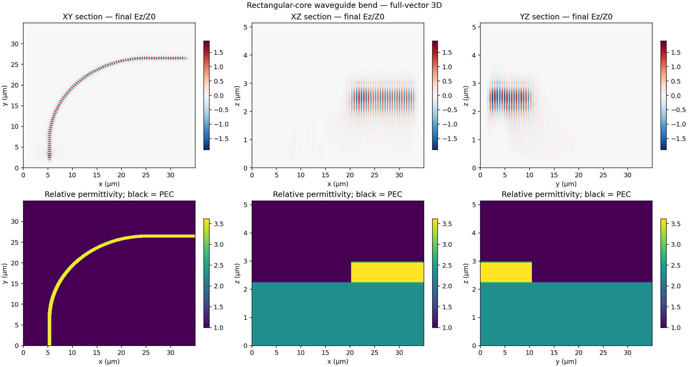

# Python FDTD: 1D, 2D, and full-vector 3D

A documented collection of **62 independently runnable electromagnetic simulations**: 14 one-dimensional cases, 24 two-dimensional cases, and 24 full-vector three-dimensional counterparts. Each experiment has an editable `CONFIG`, a stable numbered name, recorded inputs, saved arrays, diagnostic plots, and optional animations.

The project reconstructs and corrects experiments associated with Larry Theran Suarez's FDTD thesis and MATLAB working archive. Shared Yee-grid solvers keep numerical corrections consistent across cases. The Python implementations are documented reconstructions, with explicit distinctions between original settings, corrected numerical errors, and added 3D modeling choices.

**Start with:** [experiment catalog](docs/EXPERIMENTS.md) · [3D guide](docs/THREE_D.md) · [saved results and downloads](docs/RESULTS.md) · [numerical methods](docs/NUMERICS.md) · [validation](docs/VALIDATION.md)



The image is an archived final field snapshot; the repository also includes an in-place live preview workflow for new notebook runs.

## Install

Python **3.12** is the recommended environment. The numerical code uses NumPy, SciPy, Matplotlib, and Pillow. Linux, macOS, and Windows can use the NumPy implementation; the optional local C accelerator is exercised in Linux/macOS CI.

```bash
git clone https://github.com/larryTheran/fdtd-python.git
cd fdtd-python
python3.12 -m venv .venv
source .venv/bin/activate
python -m pip install --upgrade pip
python -m pip install -r requirements-dev.txt
```

On Windows, activate with `.venv\Scripts\activate` instead. `requirements.txt` installs runtime dependencies alone. [requirements-tested.txt](requirements-tested.txt) records the original archived environment; it is historical evidence rather than a universal lockfile. [constraints-ci.txt](constraints-ci.txt) records the stable Python 3.12 scientific versions used for the publication checks and CI. To use that combination, add `-c constraints-ci.txt` to the install command.

## Run one simulation

| Dimension | Cases | Example | Solver and output location |
|---|---:|---|---|
| 1D | 14 | Free space, TF/SF, layered dielectrics, Ohmic/integral loss, PEC | `fdtd/one_d.py` → `results/<name>/` |
| 2D | 24 | Point/plane sources, PML, slits, refraction, mirrors, reconstructed bend | `fdtd/two_d.py` → `results/<name>/` |
| 3D | 24 | Six-field vector counterparts of 2D IDs 15–38 | `fdtd/three_d.py` → `results_3d/<name>/` |

```bash
# 1D lossless dielectric stack
python experiments/one_d/06_lossless_two_layers.py --gif

# 2D single-slit diffraction
python experiments/two_d/25_single_slit_L25.py --gif

# 3D finite rectangular apertures
python experiments_3d/29_double_slit_L15_3d.py --gif

# Inspect a configuration without running it
python experiments_3d/38_waveguide_bend_3d.py --describe
```

A default 3D run can require substantial memory and time. A startup check can shorten the duration and select the reference backend:

```bash
python experiments_3d/15_free_space_sine_3d.py \
  --backend numpy --steps 8 --no-plots --output runs/smoke-3d
```

This checks startup and output generation, **not** propagation completion or convergence. Use `--help` on any experiment for supported overrides. Re-running the default output path replaces that experiment's files; choose `--output runs/my-study` for parameter sweeps and comparisons.

## Select experiments or run batches

```bash
python run_all.py --list
python run_all.py --only 2 6 19 31 --gif --frames 60
python run_all.py --group one_d --no-plots --output runs/one-d-study
python run_all_3d.py --list
python run_all_3d.py --only 25 26 28 29 --gif --frames 30
python run_all_3d.py --resume --gif --frames 30
```

Batch runners execute sequentially. The 3D `--resume` option verifies configuration, solver hashes, complete field arrays, and requested output files before reusing a run. It recomputes missing or stale cases. Full batches are user-run research workloads; continuous integration uses small physics and integration fixtures.

## Explore all cases

| IDs | Physical examples |
|---|---|
| 01–05 | 1D propagation, absorbing/periodic boundaries, normal TF/SF, vacuum spectra |
| 06–07 | Dielectric layers and configurable multilayer stack |
| 08–12 | Ohmic/integral-current loss with optical and centimeter interpretations separated |
| 13–14 | Periodic dielectric stack and true PEC reflection |
| 15–24 | Free-space point/plane waves, mixed PML/periodic boundaries, lossy media |
| 25–30 | Finite single/double slits and near/far-field comparison geometries |
| 31–34 | Refraction, partial reflection, PEC mirror, and three media |
| 35–38 | Mur refraction, diagonal source array, legacy slit case, waveguide-bend reconstruction |

The [full catalog](docs/EXPERIMENTS.md) gives every original 1D/2D script, grid, step count, and thesis/source mapping. The [3D guide](docs/THREE_D.md) describes the 24 counterparts and the depth, source, material, and boundary choices added to each.

## Saved results

The full numerical results, animations, and original report files are distributed as **GitHub release downloads**, with browsable preview images, configuration/diagnostic records, and checksums in the repository. This keeps multi-gigabyte field volumes out of Git history while making every archived file retrievable.

See [the result catalog and restore instructions](docs/RESULTS.md). Restored folders use the solver's original paths, `results/` and `results_3d/`. No saved result has been silently replaced by a shortened demonstration run.

Typical files are:

- `config.json`: exact physical and numerical inputs.
- `diagnostics.json`: numerical metrics, units, definitions, and solver provenance.
- `data.npz`: field arrays, material maps, snapshots, sampled energy, detector/spectral data as applicable.
- PNG figures and `animation.gif` when requested.

```python
from pathlib import Path
import numpy as np

folder = Path("results/06_lossless_two_layers")
with np.load(folder / "data.npz", allow_pickle=False) as result:
    electric = result["e"]
    time_seconds = result["time"]
```

Three-dimensional arrays use `(x, y, z)` order and include `ex`, `ey`, `ez`, `hx`, `hy`, and `hz`. Consult [3D output definitions](docs/THREE_D.md#saved-outputs) before combining staggered components.

## Live plots in PyLab or Jupyter

The 3D runner detects an IPython kernel and updates a single six-panel figure during execution: XY/XZ/YZ `Ez/Z0` sections over matching material maps, with step count, physical time, and the sampled energy proxy. It copies three 2D sections per published frame and retains no additional full-volume movie.

[PyLab Native 0.7.3](https://github.com/larryTheran/pylab-native) supports these in-place Jupyter display-ID updates. In a fresh notebook kernel, import an experiment or use its `main(CONFIG)` entry point. After updating modules, restart the kernel once so cached imports are refreshed. Notebook preview defaults to four intermediate updates per second; actual speed depends on computation and PNG rendering.

```python
main(CONFIG, ["--live-fps", "2", "--live-stride", "5"])
# Disable live preview while retaining ordinary final plots:
main(CONFIG, ["--no-live"])
```

Terminal defaults are unchanged. `--no-plots` disables automatic preview; explicit `--live` requires an IPython kernel. Optional notebook dependencies are in [requirements-notebook.txt](requirements-notebook.txt). A tiny real-Jupyter validation can be run with `python tools/check_live_fdtd.py`; it never launches a full default experiment. More details are in the [3D guide](docs/THREE_D.md#live-field-evolution-in-pylab-and-jupyter).

## Optional native backend

`--backend numpy` selects the complete Python/NumPy reference implementation. The 3D default `--backend auto` compiles a small local C curl/absorbing-memory accelerator when a compatible C compiler is available and otherwise uses NumPy. `--backend native` explicitly requests the accelerator. Compiler output stays under `.cache/fdtd3d/`; no prebuilt native binary or GPU dependency is shipped.

On macOS, Xcode Command Line Tools supply a compiler. On Linux, install a compatible C toolchain through the operating system. Native execution can use three workers for independent field components within each Yee phase, with a synchronization barrier between H and E phases; `--workers 1` selects sequential native execution. Tests compare the native and NumPy fields, and threaded/sequential native results.

## Verify and reproduce

```bash
python -m pip install -r requirements-dev.txt -r requirements-notebook.txt -c constraints-ci.txt
python -m pytest -q
python tools/check_live_fdtd.py
```

Automated coverage includes analytical wave speed, Fresnel amplitude/phase, lossless spectra, conductivity attenuation, 2D symmetry and diffraction checks, 3D vector/absorbing-boundary behavior, configuration rejection, native/NumPy agreement, saved outputs, and bounded live preview. Test output files use temporary directories. Historical completed-run reports are preserved in [1D/2D validation](docs/VALIDATION.md) and [3D validation](docs/THREE_D_VALIDATION.md), and [public-repository checks](docs/PUBLICATION_CHECKS.md); a successful run is not a claim that every geometry has been converged for publication.

To reproduce an archived run, restore its release files, inspect `config.json`, use the matching script/configuration and environment record, retain the diagnostics/solver hashes, and rerun into a separate `--output` folder. Solver updates can make old solver hashes differ without changing the archived files; keep that provenance distinction explicit.

## Numerical interpretation

- Fields use `E/Z0` and corresponding H amplitudes with arbitrary source normalization. Detector curves and sampled energy are diagnostic proxies, not calibrated watts, joules, irradiance, or bend insertion loss.
- E/H components are staggered in space and time; direct products require interpolation and normalization before physical power claims.
- Optical and legacy centimeter-grid interpretations are separate cases. An `n=1.5 → 4` interface partially reflects; it is not total internal reflection.
- Materials are nondispersive, isotropic, nonmagnetic dielectrics with optional conductivity. Dispersive/nonlinear media and calibrated vector port extraction require additional models.
- Finite apertures, PML clearance, mesh/depth/time convergence, oblique incidence, and staircased curved/high-index interfaces need independent checks for quantitative studies.

See [methods and corrections](docs/NUMERICS.md), [source audit](docs/SOURCE_AUDIT.md), and [the 3D limitations](docs/THREE_D.md#validation-and-research-use).

## Repository map

```text
fdtd/                  Shared 1D, 2D, and six-component 3D solvers and plotting
experiments/one_d/     14 one-dimensional scripts
experiments/two_d/     20 primary two-dimensional scripts
experiments/supplemental/  4 documented two-dimensional reconstructions
experiments_3d/        24 full-vector three-dimensional counterparts
tests/                 Physics, configuration, CLI, backend, and live-preview checks
tools/                 Report generation, archive audit, and Jupyter smoke check
docs/                  Catalog, methods, provenance, validation, result download guide
results-catalog/       Browsable archived-result metadata and preview images
research_reviews/     Separate proposed research directions and literature reviews
```

The historical [project guide](docs/PROJECT_GUIDE.md) is retained. Original MATLAB/PDF/archive assets are described by the provenance inventory; they are not automatically included or relicensed by this Python repository. `tools/audit_sources.py` is an archive-specific utility requiring the original source collection; see [development notes](CONTRIBUTING.md) before regenerating provenance.

## Attribution, reuse, and contributions

Please retain the thesis/source mappings and distinguish reproduced experiments from proposed research. [CITATION.cff](CITATION.cff) provides project citation metadata. [LICENSING.md](LICENSING.md) records the current licensing status; publication here does not invent a new license for the code or third-party reference materials. Read [CONTRIBUTING.md](CONTRIBUTING.md) for changes, tests, and result submissions.
